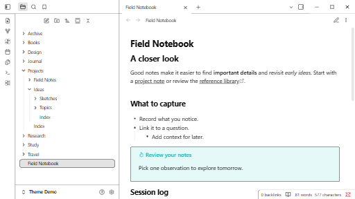

# E Ink Reader

A practical monochrome Obsidian theme for actual e-ink devices.

The theme supports Light mode. See [manifest.json](manifest.json) for the source version and minimum Obsidian version. The preview was captured in Obsidian 1.15.1 on Windows.

The theme uses monochrome colours, disables CSS animations and transitions, and adds outlines to focused controls. Display ghosting and cursor behaviour have not been verified on physical e-ink hardware.

## Preview



## Install manually

1. Download `manifest.json` and `theme.css` from the [latest published release](https://github.com/tutivsoft-com/obsidian-theme-e-ink-reader/releases/latest).
2. Put both files in `.obsidian/themes/E Ink Reader/` in your vault.
3. Open **Settings > Appearance**, set the base colour scheme to **Light**, and select **E Ink Reader**.

## Run the source checks

```text
python -m pip install "cssselect2>=0.8,<1" "tinycss2>=1.4,<2"
python -B -m unittest discover -s tests -v
```

The tests parse the stylesheet and check the matching styles for sample editor, reading and navigation elements.

See the [original design plan](PLAN.md). [MIT license](LICENSE).
